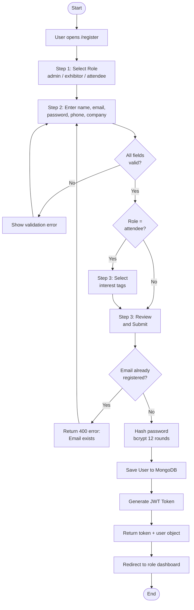
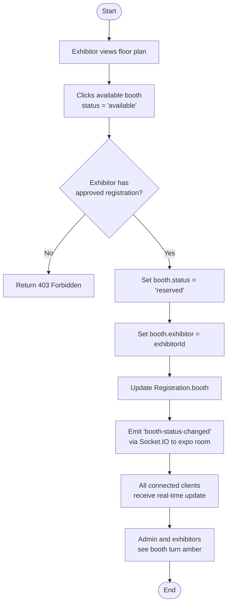
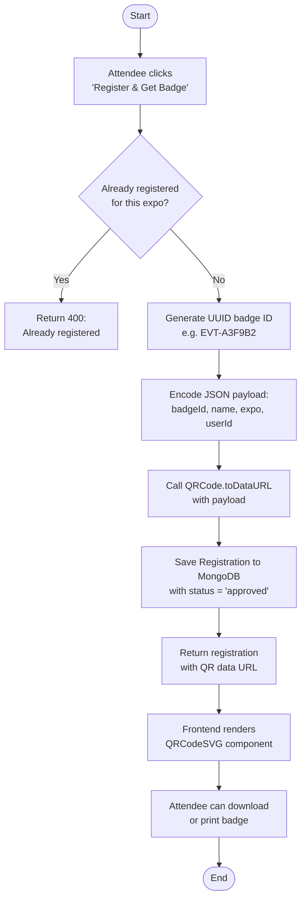

# eProject Report
## EventSphere — Expo Management Platform

**Student Name:** Sheikh Maaz Abdullah
**Enrollment Number:** 1335472
**Curriculum:** Advanced Diploma in Software Engineering (ADSE)
**Centre:** Aptech FB Area, Karachi
**Semester:** 5
**Start Date:** 05 May 2026
**End Date:** 04 June 2026

---

# Acknowledgements

I would like to express my sincere gratitude to all those who supported and guided me throughout the development of this eProject.

First and foremost, I am deeply grateful to **Aptech Computer Education** for designing the eProject initiative, which provides students with an invaluable opportunity to apply theoretical knowledge in a real-world, practical setting. The eProject framework has significantly enhanced my understanding of software engineering principles and modern full-stack development.

I extend my heartfelt thanks to the faculty and mentors at **Aptech FB Area, Karachi**, whose patient guidance, constructive feedback, and domain expertise shaped the direction of this project. Their timely reviews during the status report phases helped me course-correct and improve the quality of the deliverable.

I am also grateful to the open-source community for the exceptional tools and libraries upon which this project is built — including the creators of Node.js, Express, MongoDB, React, Tailwind CSS, Socket.IO, and the many npm packages that made this work possible.

Finally, I thank my family for their unwavering patience, encouragement, and support throughout long development sessions. This project is as much a product of their belief in me as it is of my own effort.

> *"Every line of code written is a step closer to turning imagination into reality."*

---

# 1. eProject Synopsis

## 1.1 Problem Statement

Trade exhibitions, expos, and conferences are multi-stakeholder events that require careful coordination between three distinct groups: **Organisers** who plan and manage the event, **Exhibitors** who showcase their products and services, and **Attendees** who visit, learn, and network. Currently, most expo management is handled through a fragmented combination of spreadsheets, email threads, printed floor maps, and manual check-in processes. This leads to:

- Inefficient booth allocation and floor plan management
- Lack of real-time visibility into booth availability for exhibitors
- Manual, paper-based attendee check-in prone to errors and fraud
- No personalised guidance to help attendees navigate large expo floors
- Poor communication channels between organisers, exhibitors, and attendees

These pain points result in a degraded experience for all stakeholders and operational inefficiencies for event organisers.

## 1.2 Proposed Solution

**EventSphere** is a comprehensive, web-based Expo Management Platform built on the MERN stack (MongoDB, Express.js, React.js, Node.js) that digitises and streamlines the entire expo lifecycle. The platform provides:

1. **A centralised Admin Dashboard** for organisers to create events, design floor plans visually, manage exhibitor registrations, schedule sessions, and monitor analytics.
2. **An Exhibitor Portal** enabling companies to apply for expo participation, select booth spaces on an interactive floor plan, and manage their public-facing booth profile.
3. **An Attendee Portal** that allows visitors to discover events, register with a unique QR-code badge, book sessions, and receive AI-powered exhibitor recommendations.
4. **Three Innovative Features:**
   - *QR Code Badge Generator:* Each registered attendee receives a unique, printable QR badge tied to their identity.
   - *AI Exhibitor Recommender:* A content-based filtering engine using Jaccard similarity matches attendees with relevant exhibitors.
   - *Interactive Virtual Floor Tour:* An animated, auto-navigating visual walkthrough of the expo floor.
5. **Real-Time Communication** via Socket.IO for instant booth status updates and in-platform messaging.

## 1.3 Technology Stack

| Layer | Technology | Version |
|---|---|---|
| Front-end Framework | React.js (Vite) | 18.2 |
| Styling | Tailwind CSS | 3.3 |
| Charting | Recharts | 2.10 |
| Back-end Framework | Express.js | 4.18 |
| Runtime | Node.js | 18+ |
| Database | MongoDB (Mongoose) | 6+ |
| Real-Time | Socket.IO | 4.6 |
| Authentication | JWT (jsonwebtoken) | 9.0 |
| Password Hashing | bcryptjs | 2.4 |
| QR Code | qrcode, qrcode.react | 1.5 |
| Validation | express-validator | 7.0 |
| Unique IDs | uuid | 9.0 |

---

# 2. eProject Analysis

## 2.1 Functional Requirements

### Admin / Organiser
- FR-01: The system shall allow admins to register and authenticate securely.
- FR-02: Admins shall be able to create, update, publish, and delete expo events.
- FR-03: Admins shall design booth floor plans on an interactive grid editor.
- FR-04: Admins shall approve or reject exhibitor registration applications.
- FR-05: Admins shall assign specific booths to approved exhibitors.
- FR-06: Admins shall create, edit, and delete session schedules for an expo.
- FR-07: Admins shall view platform analytics including booth occupancy, registrations, and monthly trends.

### Exhibitor
- FR-08: Exhibitors shall register accounts and apply to participate in published expos.
- FR-09: Approved exhibitors shall view the live floor plan and reserve available booths.
- FR-10: Exhibitors shall update their booth profile (products, services, tags, description).
- FR-11: Exhibitors shall send and receive messages within the platform.

### Attendee
- FR-12: Attendees shall browse and register for published expos.
- FR-13: On registration, a unique QR badge shall be automatically generated.
- FR-14: Attendees shall book and cancel individual sessions within an expo.
- FR-15: Attendees shall receive AI-powered exhibitor recommendations based on their interests.
- FR-16: Attendees shall explore an interactive virtual floor plan tour.

## 2.2 Non-Functional Requirements

- **Security:** All passwords hashed (bcrypt, 12 rounds). All protected routes require valid JWT Bearer tokens. Role-based access enforced server-side.
- **Performance:** API responses under 500ms on local hardware. Socket.IO events delivered in under 100ms on LAN.
- **Scalability:** Mongoose schemas indexed for common queries. MongoDB supports horizontal scaling.
- **Usability:** Responsive across desktop (1920px), laptop (1366px), and tablet (768px) breakpoints.
- **Maintainability:** Modular React components, separated route controllers, and well-commented code throughout.
- **Reliability:** Global Express error handler prevents unhandled crashes. MongoDB exits the process on initial connection failure for fast failure detection.

## 2.3 Feasibility Study

### Technical Feasibility
All chosen technologies are open-source, well-documented, and widely adopted in industry. The MERN stack is a standard for modern web applications and is supported on all major operating systems. No proprietary APIs or paid services are required.

### Economic Feasibility
The entire project is built using free, open-source tools. Deployment can be achieved at zero cost using platforms such as Vercel (frontend), Render (backend), and MongoDB Atlas (database free tier). There is no licensing cost.

### Operational Feasibility
The platform is designed with clear, role-separated interfaces that require minimal training. The registration flow is three steps. The admin dashboard follows established dashboard UX patterns familiar to any computer user.

## 2.4 User Stories

| ID | As a... | I want to... | So that... |
|---|---|---|---|
| US-01 | Admin | Create and publish an expo | Exhibitors and attendees can register |
| US-02 | Admin | Design a floor plan | Exhibitors can see available booth locations |
| US-03 | Admin | Approve exhibitor applications | Only vetted companies participate |
| US-04 | Admin | View analytics | I can track event performance |
| US-05 | Exhibitor | Apply for an expo | I can showcase my products |
| US-06 | Exhibitor | Reserve a booth on the floor plan | I have a confirmed space |
| US-07 | Exhibitor | Update my booth profile | Attendees know what I offer |
| US-08 | Attendee | Register for an expo | I get a unique QR badge for entry |
| US-09 | Attendee | Book sessions | I can plan my schedule |
| US-10 | Attendee | Get AI recommendations | I find the most relevant exhibitors quickly |
| US-11 | Attendee | Take a virtual tour | I can plan my visit before arriving |

---

# 3. eProject Design

## 3.1 Data Flow Diagrams (DFDs)

### 3.1.1 Context Level DFD (Level 0)

```
                        ┌─────────────────────────────┐
                        │                             │
   Admin ──────────────►│                             │──────────────► Admin
   (Expo Data,          │   EVENTSPHERE               │   (Dashboards,
    Session Data)       │   MANAGEMENT                │    Analytics,
                        │   SYSTEM                    │    Reports)
   Exhibitor ──────────►│                             │──────────────► Exhibitor
   (Registration,       │                             │   (Approval Status,
    Booth Data)         │                             │    Booth Confirmation)
                        │                             │
   Attendee ───────────►│                             │──────────────► Attendee
   (Registration,       │                             │   (QR Badge,
    Session Bookings)   │                             │    Recommendations,
                        │                             │    Tour)
                        └─────────────────────────────┘
                                      │
                                      ▼
                               MongoDB Database
```

The system accepts inputs from three external entities (Admin, Exhibitor, Attendee) and produces corresponding outputs. All data is persisted to MongoDB.

### 3.1.2 Level 1 DFD

**Process 1.0 — User Authentication**
- Input: Email, Password, Role
- Process: Validate credentials → Hash password → Generate JWT
- Output: JWT Token, User Object
- Data Store: Users

**Process 2.0 — Expo Management**
- Input: Expo details from Admin
- Process: Validate → Create/Update MongoDB document → Broadcast via Socket.IO
- Output: Expo record, confirmation
- Data Store: Expos

**Process 3.0 — Floor Plan & Booth Management**
- Input: Grid layout from Admin, Booth selection from Exhibitor
- Process: Save floor plan cells → Create/update Booth documents → Emit real-time event
- Output: Updated floor plan, Booth assignment confirmation
- Data Store: Expos (floorPlan), Booths

**Process 4.0 — Registration & QR Badge Generation**
- Input: Expo ID, Attendee/Exhibitor data
- Process: Create Registration → Generate UUID badge ID → Generate QR code data URL
- Output: Registration document with QR code
- Data Store: Registrations

**Process 5.0 — AI Recommendation**
- Input: Attendee interests, Expo ID
- Process: Fetch exhibitor booth tags → Tokenise → Compute Jaccard scores → Sort
- Output: Ranked exhibitor list with match percentages
- Data Store: Booths, Users

**Process 6.0 — Session Booking**
- Input: Session ID, Attendee ID
- Process: Check capacity → Add/remove attendee → Update Registration → Emit Socket.IO event
- Output: Booking confirmation, updated seat count
- Data Store: Sessions, Registrations

## 3.2 Flowcharts

### 3.2.1 User Registration Flow



### 3.2.2 Booth Reservation Flow



### 3.2.3 Attendee Registration + QR Generation



## 3.3 Process / Sequence Diagrams

### 3.3.1 Login Sequence

```
Browser         React AuthContext       Axios API         Express Server      MongoDB
   |                   |                    |                    |                |
   |--submit form----->|                    |                    |                |
   |                   |--POST /auth/login->|                    |                |
   |                   |                   |--POST /auth/login-->|                |
   |                   |                   |                    |--findOne({email})|
   |                   |                   |                    |<-----user doc---|
   |                   |                   |                    |                |
   |                   |                   |                    |--bcrypt.compare-|
   |                   |                   |                    |<----true/false--|
   |                   |                   |                    |                |
   |                   |                   |                    |--generateToken--|
   |                   |                   |<---200 {token,user}|                |
   |                   |<--{token,user}-----|                    |                |
   |                   |--setUser/setToken--|                    |                |
   |                   |--localStorage------                    |                |
   |<--navigate to-----|                                        |                |
   |   dashboard        |                                        |                |
```

### 3.3.2 Real-Time Booth Reservation Sequence

```
ExhibitorBrowser    React Component    Express API    MongoDB    Socket.IO    AdminBrowser
     |                    |                |              |           |             |
     |--click booth------>|                |              |           |             |
     |                    |--PUT reserve-->|              |           |             |
     |                    |               |--update booth-|           |             |
     |                    |               |<--booth doc---|           |             |
     |                    |               |--emit 'booth-status-changed'----------->|
     |                    |               |               |           |             |
     |<---toast success---|               |               |           |             |
     |                    |               |               |           |--update UI-->|
     |                    |               |               |           |(booth turns  |
     |                    |               |               |           | amber)       |
```

## 3.4 Database Design

### 3.4.1 Entity-Relationship Description

The database has **6 collections** in MongoDB:

- **Users** — central identity store for all roles. One user has many Registrations.
- **Expos** — event definitions created by admin users. One expo has many Booths, Sessions, and Registrations.
- **Booths** — individual exhibit spaces. Each booth belongs to one Expo and may be assigned to one User (exhibitor).
- **Sessions** — scheduled talks/workshops. Each session belongs to one Expo and has many registered Users (attendees).
- **Registrations** — join entity connecting Users to Expos with role, status, badge ID, QR code, and references to Booth and Sessions.
- **Messages** — chat messages between Users, optionally scoped to an Expo.

### 3.4.2 MongoDB Schema Definitions

#### Users Collection
```javascript
{
  _id:         ObjectId,           // auto-generated
  name:        String,             // required, max 100 chars
  email:       String,             // required, unique, lowercase
  password:    String,             // bcrypt hash, select: false
  role:        String,             // enum: admin | exhibitor | attendee
  phone:       String,             // optional
  company:     String,             // optional (used by exhibitors/admins)
  bio:         String,             // max 500 chars
  interests:   [String],           // for AI recommendations (attendees)
  avatar:      String,             // URL
  isVerified:  Boolean,            // default true
  createdAt:   Date,               // auto (timestamps)
  updatedAt:   Date                // auto (timestamps)
}
```

#### Expos Collection
```javascript
{
  _id:         ObjectId,
  title:       String,             // required
  description: String,
  startDate:   Date,               // required
  endDate:     Date,               // required
  location:    String,             // required
  theme:       String,
  category:    String,
  bannerColor: String,             // hex colour for UI
  status:      String,             // enum: draft|published|ongoing|completed|cancelled
  organizer:   ObjectId → User,    // required ref
  floorPlan: {
    rows:      Number,
    cols:      Number,
    cells:     [{row, col, type, label}]  // type: booth|aisle|entrance|empty
  },
  maxBooths:   Number,
  tags:        [String],
  createdAt:   Date,
  updatedAt:   Date
}
```

#### Booths Collection
```javascript
{
  _id:         ObjectId,
  expo:        ObjectId → Expo,    // required ref, indexed
  boothNumber: String,             // e.g. "A1" — unique per expo
  size:        String,             // enum: small | medium | large
  position: {
    row:       Number,
    col:       Number
  },
  status:      String,             // enum: available | reserved | occupied
  exhibitor:   ObjectId → User,    // nullable
  price:       Number,
  products:    [String],
  services:    [String],
  description: String,
  tags:        [String],           // used by AI recommender
  category:    String,
  createdAt:   Date,
  updatedAt:   Date
}
// Compound index: { expo: 1, boothNumber: 1 }, unique: true
```

#### Sessions Collection
```javascript
{
  _id:                 ObjectId,
  expo:                ObjectId → Expo,
  title:               String,
  speaker:             String,
  speakerBio:          String,
  description:         String,
  startTime:           Date,
  endTime:             Date,
  venue:               String,
  capacity:            Number,     // default 100
  tags:                [String],
  registeredAttendees: [ObjectId → User],
  createdAt:           Date,
  updatedAt:           Date
}
```

#### Registrations Collection
```javascript
{
  _id:        ObjectId,
  user:       ObjectId → User,     // required
  expo:       ObjectId → Expo,     // required
  role:       String,              // enum: exhibitor | attendee
  status:     String,              // enum: pending | approved | rejected
  badgeId:    String,              // UUID-based, unique
  qrCode:     String,              // base64 data URL of QR image
  booth:      ObjectId → Booth,    // nullable
  sessions:   [ObjectId → Session],
  company:    String,              // exhibitor only
  documents:  [String],            // future: file URLs
  interests:  [String],            // attendee only
  checkedIn:  Boolean,
  createdAt:  Date,
  updatedAt:  Date
}
// Compound index: { user: 1, expo: 1, role: 1 }, unique: true
```

#### Messages Collection
```javascript
{
  _id:       ObjectId,
  sender:    ObjectId → User,     // required
  receiver:  ObjectId → User,     // required
  expo:      ObjectId → Expo,     // optional context
  content:   String,              // max 2000 chars
  read:      Boolean,             // default false
  createdAt: Date,
  updatedAt: Date
}
```

---

# 4. Screenshots

The following screenshots should be captured during the demo and inserted at these locations in the final Word document:

| # | Page | What to capture |
|---|---|---|
| SS-01 | Landing Page | Full landing page hero section with animated orbs and mockup dashboard |
| SS-02 | Register — Step 1 | Role selection cards (Attendee, Exhibitor, Organiser) |
| SS-03 | Register — Step 2 | Basic info form with password field |
| SS-04 | Register — Step 3 | Interest tags selection (for attendee) |
| SS-05 | Login Page | Login form with demo quick-login buttons |
| SS-06 | Admin Dashboard | Stat cards + bar chart + pie chart + recent expos table |
| SS-07 | Expo Management | Expo grid cards with colour banners and status badges |
| SS-08 | Create Expo Modal | Create expo form with colour picker and date fields |
| SS-09 | Floor Plan Editor | Grid canvas with drawn booths, aisles, and entrance |
| SS-10 | Floor Plan — Saved | Floor plan showing occupied (rose) and reserved (amber) booths |
| SS-11 | Exhibitor Manager | Table with pending/approved/rejected applications + approve buttons |
| SS-12 | Session Manager | Session cards with timings, speaker names, and seat counts |
| SS-13 | Analytics Page | Charts for expo trends, booth distribution pie, registrations bar |
| SS-14 | Exhibitor Dashboard | Dashboard showing registered expos and status cards |
| SS-15 | Booth Selection | Exhibitor's interactive floor plan with available booth highlighted |
| SS-16 | Booth Details Form | Products/services/tags form after reservation |
| SS-17 | Messages | Chat interface showing conversation thread |
| SS-18 | Attendee Dashboard | Quick action cards and registered expos list |
| SS-19 | Event Browse | Expo cards grid with Register button |
| SS-20 | Session Booking | Grouped by date, book/cancel buttons, seat counts |
| SS-21 | QR Badge — Full | Complete badge card with QR code, name, dates, badge ID |
| SS-22 | QR Badge — Download | Browser save dialog for PNG download |
| SS-23 | AI Recommendations | Ranked exhibitor cards with match % bars and highlighted tags |
| SS-24 | AI — Interest Edit | Interest tag selection panel open for editing |
| SS-25 | Virtual Tour | Floor grid with one booth pulsing in tour mode and detail panel |
| SS-26 | Virtual Tour — Stats | Stats panel on right showing booth occupancy breakdown |

---

# 5. Source Code with Comments

The complete, thoroughly commented source code is located in the project repository under the following structure. Each file contains inline JSDoc/inline comments explaining logic, parameters, and design decisions.

**Key files reference:**

| File | Purpose |
|---|---|
| `backend/server.js` | Express + Socket.IO entry point |
| `backend/models/User.js` | User schema with bcrypt hook |
| `backend/models/Booth.js` | Booth schema with compound index |
| `backend/middleware/auth.js` | JWT protect + role authorize |
| `backend/utils/aiRecommender.js` | Jaccard similarity algorithm |
| `backend/routes/auth.js` | Register, login, profile endpoints |
| `backend/routes/admin.js` | Full admin CRUD + analytics |
| `backend/routes/attendee.js` | Registration, QR, sessions, AI |
| `frontend/src/context/AuthContext.jsx` | Global auth state management |
| `frontend/src/hooks/useSocket.js` | Singleton Socket.IO hook |
| `frontend/src/pages/admin/FloorPlanEditor.jsx` | Interactive grid editor |
| `frontend/src/pages/attendee/QRBadge.jsx` | QR generation and download |
| `frontend/src/pages/attendee/AIRecommendations.jsx` | Recommendation UI |
| `frontend/src/pages/attendee/VirtualTour.jsx` | Animated floor tour |

All source code is included in the project ZIP file submitted alongside this report.

---

# 6. User Guide

## 6.1 Accessing the Application
Open a web browser and navigate to **http://localhost:5173** (development) or the production URL. The system works on Chrome, Firefox, Edge, and Safari.

## 6.2 Admin / Organiser Guide

### Creating an Account
1. Click **Get Started** on the home page.
2. Select **Organiser** as your role.
3. Enter your full name, email address, and a password (minimum 6 characters).
4. Enter your company/organisation name.
5. Click **Create Account**.

### Creating an Expo
1. From the Admin Dashboard, click **New Expo** (top right) or navigate to **Expo Management**.
2. Click **Create Expo**.
3. Fill in the title, description, start and end dates, location, theme, and maximum booths.
4. Choose a banner colour using the colour picker.
5. Click **Create Expo** to save.

### Designing the Floor Plan
1. On the Expo card, click **Floor Plan**.
2. Select a drawing tool from the left panel: **Booth**, **Aisle**, **Entrance**, or **Erase**.
3. Click grid cells to paint them. Booth cells receive automatic labels (A1, B2, etc.).
4. Adjust the grid rows and columns using the sliders.
5. Click **Save Plan** to persist the layout and create booth records.

### Managing Exhibitor Applications
1. Click **Exhibitors** on the Expo card.
2. Review pending applications.
3. Click the green ✓ button to approve, or the red ✗ button to reject.
4. For approved exhibitors without a booth, use the **Assign Booth** dropdown.

### Adding Sessions
1. Click **Sessions** on the Expo card (via `/admin/expos/:id/sessions`).
2. Click **Add Session**.
3. Fill in the title, speaker, start/end times, venue, capacity, and tags.
4. Click **Create**.

### Viewing Analytics
1. Navigate to **Analytics** in the left sidebar.
2. View KPI cards (expos, users, registrations, booths).
3. Review charts for expo creation trends, booth distribution, and registrations by role.

## 6.3 Exhibitor Guide

### Registering for an Expo
1. Browse to **Browse Events** (the attendee section, as expos are public).
2. Click **Register & Get Badge** on an expo you wish to exhibit at. Note: For exhibitors, you then apply through the Exhibitor Portal.
3. From the Exhibitor Dashboard, your application status will show as **Pending** until an admin approves it.

### Reserving a Booth
1. Once your application is **Approved**, click **Reserve Booth** on the Dashboard or navigate to `/exhibitor/booth/:expoId`.
2. The floor plan shows colour-coded booths: green = available.
3. Click an available booth to see its details, then click **Reserve This Booth**.
4. Fill in your booth profile: products, services, category, tags, and description.
5. Click **Save Details**.

### Updating Your Profile
1. Navigate to **My Profile** in the sidebar.
2. Update your name, phone, company, bio, and industry tags.
3. Click **Save Profile**.

### Messaging
1. Navigate to **Messages** in the sidebar.
2. Click on a conversation thread to view and reply.
3. Press **Enter** or click the send button to send a message.

## 6.4 Attendee Guide

### Registering for an Expo
1. Navigate to **Browse Events** in the sidebar.
2. Browse the list of published expos.
3. Click **Register & Get Badge** on any expo.
4. Your QR badge is automatically generated.

### Accessing Your QR Badge
1. From the Dashboard, click **Badge** next to any registered expo.
2. Your unique QR badge card is displayed.
3. Click **Download as PNG** to save it, or **Print Badge** to print it.
4. Present this badge at the expo entrance for check-in.

### Booking Sessions
1. From the Dashboard, click **Sessions** next to an expo.
2. Sessions are grouped by date.
3. Click **Book** next to any session to reserve your seat.
4. Click **Booked** (now shown in green) to cancel a booking.

### Getting AI Recommendations
1. Click **AI Match** next to a registered expo.
2. View ranked exhibitors with percentage match scores.
3. Click **Edit** on the Interests section to add or remove tags.
4. Click **Save & Refresh** to update recommendations.

### Taking the Virtual Tour
1. Click **Tour** next to a registered expo.
2. Hover over booths to see quick previews.
3. Click any booth for full details in the panel.
4. Click **Start Virtual Tour** to activate auto-tour mode.
5. Use the **⏮ ⏭** buttons to navigate manually, or **⏸ Stop Tour** to exit.

---

# 7. Developer's Guide

## 7.1 Prerequisites
- Node.js v18+, npm v9+
- MongoDB 6+ (local or Atlas)
- Git

## 7.2 Installation
See `README.md` in the project root for step-by-step installation and environment setup.

## 7.3 Folder Structure

```
eventsphere/
├── backend/
│   ├── config/
│   │   └── db.js              ← MongoDB connection (connectDB function)
│   ├── middleware/
│   │   └── auth.js            ← protect() and authorize(...roles) middleware
│   ├── models/                ← Mongoose schemas (User, Expo, Booth, Session,
│   │                              Registration, Message)
│   ├── routes/                ← Express routers (auth, admin, exhibitor,
│   │                              attendee, expo)
│   ├── utils/
│   │   ├── generateToken.js   ← JWT signing helper
│   │   └── aiRecommender.js   ← Jaccard similarity recommendation engine
│   └── server.js              ← App entry, Socket.IO setup, middleware chain
│
└── frontend/
    ├── index.html             ← Vite root HTML
    ├── tailwind.config.js     ← Custom colour palette, animations, keyframes
    ├── vite.config.js         ← Dev server proxy (/api → :5000)
    └── src/
        ├── main.jsx           ← ReactDOM root render, Toaster config
        ├── App.jsx            ← BrowserRouter, all route definitions
        ├── index.css          ← Tailwind layers, global component classes
        ├── context/
        │   └── AuthContext.jsx ← useAuth hook, login/register/logout
        ├── hooks/
        │   └── useSocket.js   ← Singleton Socket.IO connection
        ├── services/
        │   └── api.js         ← Axios instance with base URL and interceptors
        ├── components/
        │   └── common/        ← Navbar, Sidebar, ProtectedRoute, LoadingSpinner
        └── pages/
            ├── Home.jsx       ← Public landing page
            ├── Login.jsx      ← Login with demo shortcuts
            ├── Register.jsx   ← 3-step registration wizard
            ├── admin/         ← Dashboard, ExpoManagement, FloorPlanEditor,
            │                      ExhibitorManager, SessionManager, Analytics
            ├── exhibitor/     ← Dashboard, BoothManagement, Profile, Messages
            └── attendee/      ← Dashboard, EventBrowse, SessionBooking,
                                   QRBadge, AIRecommendations, VirtualTour
```

## 7.4 Key Functions Reference

### Backend

| Function | File | Description |
|---|---|---|
| `connectDB()` | `config/db.js` | Async MongoDB connection; exits process on failure |
| `protect` | `middleware/auth.js` | Verifies JWT; attaches `req.user` |
| `authorize(...roles)` | `middleware/auth.js` | Checks `req.user.role` against allowed roles |
| `generateToken(id)` | `utils/generateToken.js` | Returns signed JWT (30d expiry) |
| `recommendExhibitors(interests, exhibitors)` | `utils/aiRecommender.js` | Jaccard similarity scoring and ranking |
| `tokenise(input)` | `utils/aiRecommender.js` | Converts string/array to lower-case word Set |
| `jaccard(setA, setB)` | `utils/aiRecommender.js` | Computes |A∩B| / |A∪B| |
| `userSchema.comparePassword(pwd)` | `models/User.js` | bcrypt compare method |
| `userSchema.pre('save')` | `models/User.js` | bcrypt hash hook |

### Frontend

| Function / Hook | File | Description |
|---|---|---|
| `useAuth()` | `context/AuthContext.jsx` | Returns `{user, token, login, register, logout, updateUser}` |
| `useSocket(userId, expoId)` | `hooks/useSocket.js` | Creates/returns singleton Socket.IO connection; joins rooms |
| `getSocket()` | `hooks/useSocket.js` | Returns current socket instance (for manual event wiring) |
| `api` | `services/api.js` | Pre-configured Axios with `/api` base and auth interceptor |

## 7.5 How to Extend

### Adding a new API route
1. Create a new file in `backend/routes/`, e.g. `sponsors.js`.
2. Define your Express router with controllers inline.
3. Import and mount in `server.js`: `app.use('/api/sponsors', sponsorsRouter)`.
4. Add corresponding Mongoose model in `backend/models/` if needed.

### Adding a new frontend page
1. Create a `.jsx` file in the appropriate `src/pages/` subdirectory.
2. Import and add a `<Route>` in `src/App.jsx`, wrapping with `<ProtectedRoute roles={[...]}>`  if needed.
3. Add a link in `src/components/common/Sidebar.jsx` under the relevant role's nav items array.

### Adding a new Socket.IO event
- **Backend (emit):** `req.io.to('expo-<id>').emit('event-name', payload)` inside any route handler.
- **Frontend (listen):** `socket.on('event-name', callback)` inside a `useEffect` in the relevant component (with cleanup `socket.off`).

## 7.6 API Error Format
All API errors return:
```json
{
  "success": false,
  "message": "Human-readable error description"
}
```
Validation errors return:
```json
{
  "success": false,
  "errors": [{ "msg": "...", "path": "fieldName" }]
}
```

## 7.7 Module Descriptions

| Module | Role | Dependencies |
|---|---|---|
| Auth Module | User registration, login, profile | bcryptjs, jsonwebtoken, express-validator |
| Admin Module | Expo CRUD, booth management, analytics | Mongoose aggregation, Socket.IO |
| Exhibitor Module | Registration, booth reservation, profile | Socket.IO emit |
| Attendee Module | Expo browse, QR generation, session booking, AI recs | qrcode, uuid, aiRecommender |
| AI Recommender | Jaccard-based content filtering | None (pure JS) |
| Real-Time Module | Socket.IO rooms for expo and user scopes | socket.io |
| Messaging Module | Thread-based in-platform chat | Socket.IO emit |
